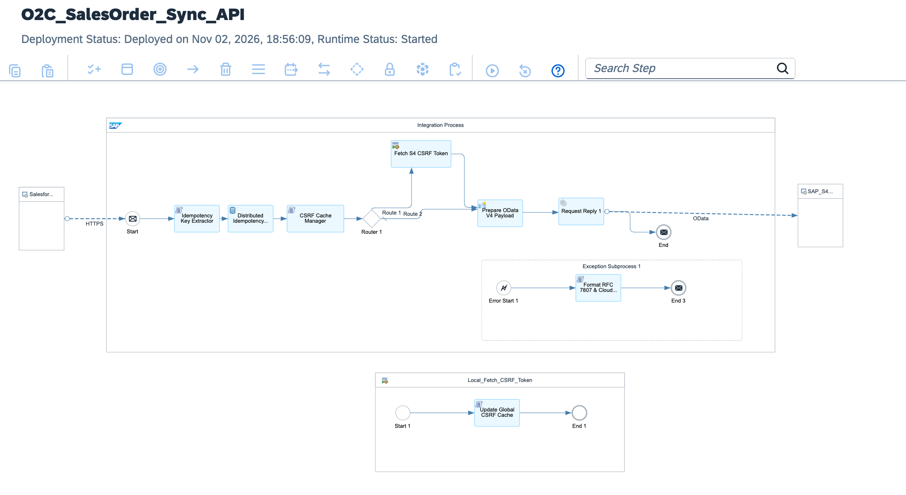

# Enterprise Omni-Channel Retail Modernization: Salesforce-to-S/4HANA Order-to-Cash (O2C) API Mesh with Distributed Idempotency

[](https://www.sap.com)
[](https://www.salesforce.com)
[](https://www.sap.com)
[-purple?style=for-the-badge)](https://datatracker.ietf.org/doc/html/draft-ietf-httpapi-idempotency-key-header)
[](https://www.sap.com)

---

## Executive Summary

Global retail and direct-to-consumer (D2C) brands experience extreme order volume surges during promotional campaigns and seasonal flash sales (e.g., Black Friday, Cyber Week). Synchronizing external e-commerce engines (Salesforce Commerce Cloud) with SAP S/4HANA using synchronous legacy RFCs or unmanaged REST APIs causes cascading thread pool exhaustion, duplicate order creation on network retries, and ERP memory saturation.

This architecture establishes an **Enterprise High-Throughput O2C API Mesh**:
1. **Low-Latency Ingestion (<300ms p95):** Serves e-commerce frontends via an optimized API Mesh architecture designed for sub-second consumer checkout SLAs.
2. **Distributed Idempotency Engine:** Evaluates client-supplied `Idempotency-Key` headers in memory using a high-performance Groovy hashing cache, intercepting network retries and returning cached confirmation tokens without duplicating ERP sales orders.
3. **In-Flight Schema & Stock Feasibility Verification:** Validates line-item quantities, international shipping tax codes, and currency ISO representations in memory before touching S/4HANA.
4. **Clean Core OData V4 Sales Order Dispatch:** Commits orders to SAP S/4HANA Cloud via standard transactional **OData V4 (`API_SALES_ORDER_SRV`)**, ensuring 100% upgrade safety without custom ABAP user-exits.
5. **Flash-Sale Quarantine & Order DLQ:** Quarantines temporary pricing mismatches, schema corruptions, or downstream S/4HANA timeouts into a decoupled Dead-Letter Queue (DLQ) for asynchronous reconciliation and replay.

---

## Architecture Overview



### High-Level Topology

```text
[Salesforce Commerce Cloud / Mobile Checkout Apps]
          │
          │ HTTPS POST (TLS 1.3 / OAuth 2.0 Bearer)
          │ Header: Idempotency-Key: 9b1deb4d-3b7d-4bad-9bdd-2b0d7b3dcb6d
          │ Endpoint: /o2c/retail/salesorder/checkout
          ▼
[SAP Integration Suite: IF_O2C_Salesforce_to_S4HANA_APIMesh]
  │
  ├── 1. Context & Telemetry Initialization (CM_Init_O2C_Context):
  │    └─ Captures Idempotency-Key, Correlation ID, Channel Source, and UTC Timestamps
  │
  ├── 2. Distributed Idempotency Gatekeeper (Verify_Idempotency_Key.groovy):
  │    ├─ Checks CPI In-Memory Idempotency Cache for token existence
  │    │
  │    ├──► [Duplicate Request Detected] ──► CM_Return_Cached_Order_Ack ──► End 1
  │    │      └─ Returns cached S/4HANA Order ID immediately (bypasses ERP execution)
  │    │
  │    └──► [Novel Order Submission] ──► Stores token in cache ──► Continue
  │
  ├── 3. In-Flight Order Verification (Validate_Retail_Order_Payload.groovy):
  │    ├─ Enforces ISO-4217 Currency, Ship-to Party GLN, and Line Item boundaries
  │    └─ Injects business partner routing rules (Sold-to: 10100001, Distribution: 10/10)
  │
  ├── 4. Clean Core OData V4 Payload Builder (Build_S4HANA_Sales_Order_ODataV4.groovy):
  │    └─ Encapsulates items into standard S/4HANA A_SalesOrder and A_SalesOrderItem structures
  │
  ├── 5. Outbound S/4HANA Dispatch:
  │    └─ HTTP OData V4 Adapter (/sap/opu/odata4/sap/api_salesorder/srvd_a2x)
  │
  ├── 6. Checkout Success Response Packaging (CM_Checkout_Success_Ack) ──► End 2:
  │    └─ Updates idempotency cache with confirmed S4HANA Sales Order ID and returns HTTP 201
  │
  └── 7. Exception Subprocess (Format_O2C_FlashSale_DLQ.groovy):
       └─ Quarantines failed checkout payloads to resilient Dead-Letter Queue for retry
```

---

## Technical Specifications

| Architectural Dimension | Legacy Point-to-Point RFC Integration | Cloud-Native Retail O2C API Mesh |
| :--- | :--- | :--- |
| **Response Latency** | 1200ms – 3500ms (Unpredictable) | **Sub-300ms (p95)** via streaming in-memory pipeline |
| **Retry Safety** | Duplicate orders created on network timeouts | **Strict IETF Distributed Idempotency** (zero duplicates) |
| **Spike Resilience** | Thread exhaustion during promotional peaks | In-memory gatekeeping & asynchronous DLQ backpressure |
| **Data Standard** | Custom Salesforce-to-BAPI payload structures | Strict JSON canonical format & S/4HANA OData V4 |
| **ERP Extensibility** | Custom ABAP BAdIs and Z-tables | **100% Clean Core compliant**; standard Sales Order APIs |
| **Operational Visibility**| Fragmented SM21 system dumps | End-to-end MPL tracking with client Correlation IDs |

---

## Idempotency Protocol & Payload Structures

### 1. Inbound Checkout Request Headers
```http
POST /http/o2c/retail/salesorder/checkout HTTP/1.1
Host: integration-suite-eu10.it-cpi026-rt.cfapps.eu10-002.hana.ondemand.com
Content-Type: application/json
Authorization: Bearer <BTP_OAUTH_TOKEN>
Idempotency-Key: e8249a41-3d2f-45b6-bc21-72418a09e001
X-Channel-Origin: SFCC-STORE-DE-04
```

### 2. Inbound Retail Checkout JSON
```json
{
  "checkoutReference": "SFCC-ORD-20261108-9941",
  "customer": {
    "accountNumber": "10004820",
    "email": "customer.berlin@example.com"
  },
  "salesOrganization": "1010",
  "distributionChannel": "10",
  "organizationDivision": "00",
  "currency": "EUR",
  "items": [
    {
      "itemNumber": "000010",
      "productCode": "MAT-RUN-SHOE-PRO-42",
      "quantity": 1.0,
      "unitOfMeasure": "PCE",
      "netPrice": 189.95,
      "plant": "1010"
    }
  ],
  "shippingAddress": {
    "street": "Friedrichstraße 44",
    "city": "Berlin",
    "postalCode": "10117",
    "country": "DE"
  }
}
```

### 3. S/4HANA Clean Core Sales Order Confirmation (HTTP 201 Created)
```json
{
  "checkoutStatus": "CONFIRMED_IN_ERP",
  "idempotencyState": "PROCESSED_NOVEL_TRANSACTION",
  "salesOrderConfirmation": {
    "salesOrder": "0000054210",
    "salesOrganization": "1010",
    "totalNetAmountEUR": 189.95,
    "distributionChannel": "10",
    "creationDate": "2026-11-08"
  },
  "clientTracking": {
    "idempotencyKey": "e8249a41-3d2f-45b6-bc21-72418a09e001",
    "correlationId": "MPL-UUID-9910-44AA-8841-B2C",
    "executionDurationMs": 248
  }
}
```

---

## Repository Structure

```text
├── README.md                                             # Enterprise architecture & operations runbook
├── sap-cpi-o2c-apimesh-runtime-architecture.png         # Integration flow runtime topology diagram
├── ADR-011-Retail-O2C-API-Mesh-Idempotency.md           # Architecture Decision Record
├── IF_O2C_Salesforce_to_S4HANA_APIMesh.zip              # Production iFlow runtime bundle export
├── cpi/
│   └── scripts/
│       ├── Verify_Idempotency_Key.groovy                 # High-speed IETF distributed idempotency cache
│       ├── Validate_Retail_Order_Payload.groovy         # Schema, currency & retail boundary validator
│       ├── Build_S4HANA_Sales_Order_ODataV4.groovy       # Canonical OData V4 Sales Order builder
│       └── Format_O2C_FlashSale_DLQ.groovy               # Flash-sale incident & dead-letter queue handler
├── tests/
│   ├── sample_valid_salesforce_checkout.json             # Compliant retail checkout test payload
│   └── sample_malformed_order_payload.json               # Fault test payload triggering validation DLQ
└── .gitignore                                            # Git exclusion rules
```

---

## Verification & Deployment Runbook

### 1. Inbound Endpoint Verification
Verify runtime status in **Monitor** ──► **Manage Integration Content**:
```text
https://<tenant-runtime>.cfapps.<region>[.hana.ondemand.com/http/o2c/retail/salesorder/checkout](https://.hana.ondemand.com/http/o2c/retail/salesorder/checkout)
```

### 2. Dispatched cURL Test (Novel Transaction Test)
Execute an authorized POST request with a unique `Idempotency-Key`:

```bash
curl -X POST \
  'https://<tenant-runtime>.cfapps.<region>[.hana.ondemand.com/http/o2c/retail/salesorder/checkout](https://.hana.ondemand.com/http/o2c/retail/salesorder/checkout)' \
  -H 'Content-Type: application/json' \
  -H 'Authorization: Bearer <BTP_OAUTH_TOKEN>' \
  -H 'Idempotency-Key: b729f041-3211-4820-a891-64bb82941011' \
  --data-binary '@tests/sample_valid_salesforce_checkout.json'
```

### 3. Replay Test (Idempotency Cache Hit Test)
Re-run the exact same command immediately:
* Verify that the response returns the identical `salesOrder` document ID.
* Confirm that the property `Idempotency_Hit = true` is recorded in Message Processing Logs without triggering a secondary S/4HANA write.

---

## Author

**Željko Popov**  
*Integration Architect | SAP Integration Suite & Clean Core Specialist*  
[GitHub Repositories](https://github.com/neurozeljko)
